# Cargo Ops Lab

Defining the measures, cleaning the data, predicting late freight, and staffing the floor to prevent it.

**Live app: [cargo-ops-lab.streamlit.app](https://cargo-ops-lab.streamlit.app/)**. Synthetic terminal. Illustrative only.

Written so that a reader with no cargo or data background can follow it. The overview tells the story of one late
shipment, chapter by chapter. Every page then opens with the short version in plain English (the question, the answer
and why it matters), and the SQL, the scores and the math follow under the hood. A Legal desk looks up any shipment's
record and tests contract promises, and an Ask the lab chat answers questions in plain words.

At an import cargo terminal, which shipments will miss their promised ready time, how many staff does each shift need
to stop that, and what happens to the plan when the flight schedule breaks? This lab answers on a simulated terminal
at a Gulf hub: 230,796 air waybills (AWBs) and 65,139 tonnes landed between April 2025 and the
data cut-off on 30 September 2026. On the normal timetable, a recommended roster gets 94.6% of shipments ready on time against 91.9% for the current roster, with 1,354 staff hours a week instead of 1,456. When 40% of flights are squeezed into two daily rush hours, the roster built for the normal timetable gets 85.1% of shipments ready on time. Re-planning the roster for the new schedule brings it back to 91.0% for 104 more staff hours a week. Keeping the recommended roster and adding a team of 4 on-call staff, called in whenever 60 or more shipments are waiting to be unpacked, does better still: 93.7% on time for 96 on-call hours a week.
Even with 20% less freight, the recommended roster falls from 94.6% to 93.8% on time once 40% of flights bunch into rush hours.

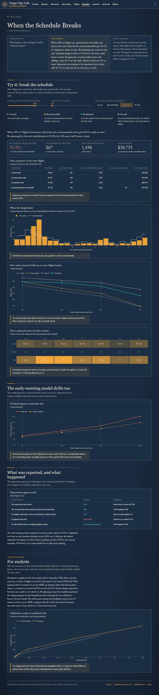

## The answer in numbers

Every figure below is read from `data/headline.json`, which the build writes from the stored results.

| Question | Answer |
|---|---|
| How often is freight ready within the promise? | 93.3% of AWBs (NFD on time), cleaned data, legacy roster |
| How long does the terminal take? | Median 1.9 hours from arrival to ready; the slowest tenth over 4.8 hours |
| Whose clock is the dwell on? | The handler holds 15.5% of the time between arrival and delivery; the customer the rest |
| What does dirty data do? | Taken as received, the feed reads 92.0% on time against a true 93.5%; after repair and quarantine, 93.3% |
| The time zone gotcha alone | Left unchecked, the time zone error alone moves on-time performance down 0.6 percentage points, from 93.5% to 92.9%. |
| Can lateness be predicted at arrival? | Gradient boosting: AUC 0.960 on the test months. Flagging the riskiest 10% of shipments when their plane lands would catch 77% of the shipments that end up late. |
| How many people per shift? | Recommended (optimized) roster: 94.6% on time on 1,354 staff hours a week, against 91.9% on 1,456 for the current (legacy) roster |
| When flights bunch into rush hours (40% moved) | Recommended roster 85.1%, re-planned 91.0%, recommended plus on-call staff 93.7%, current roster 82.8% |
| Does the risk model hold? | The early-warning model, trained on normal months, expects 14.3% of shipments to be late on the bunched schedule; in fact 16.9% are. It still puts the riskiest shipments first almost as well as before (ranking accuracy 0.959 on the normal timetable, 0.954 here), so its order holds but its odds need updating. |

## Screenshots

| | |
|---|---|
| 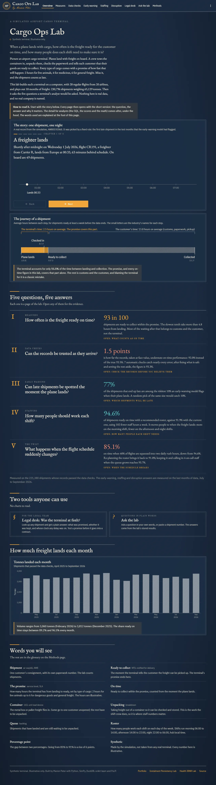 **Overview**: the terminal in one minute, the story of one late shipment, five questions with their answers | 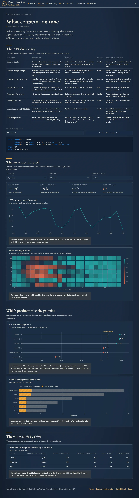 **Measures**: the KPI dictionary in plain words, live filters, on time by hour and weekday, terminal against customer time |
| 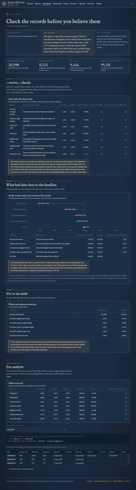 **Data checks**: a check per planted error, how much each catches, the headline under five versions of the records | 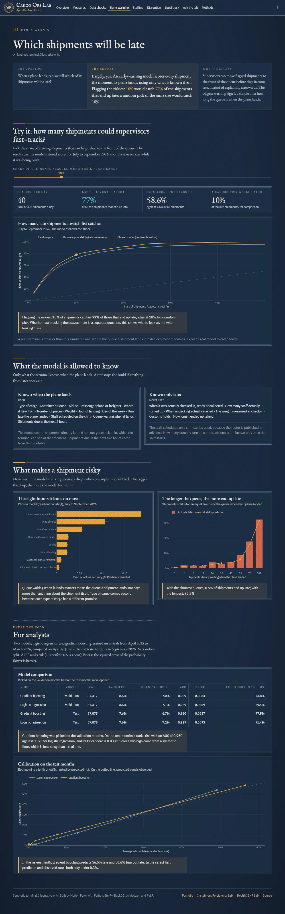 **Early warning**: the fast-track slider, what the model may use, what makes a shipment risky, calibration |
| 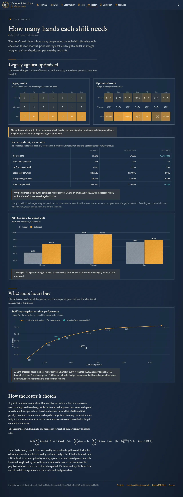 **Staffing**: current against recommended, service and cost, what extra hours buy, the integer program | 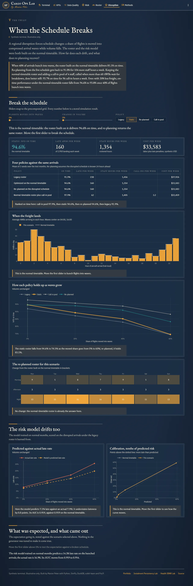 **Disruption**: four staffing responses to the same broken schedule, and the model's drift |
| 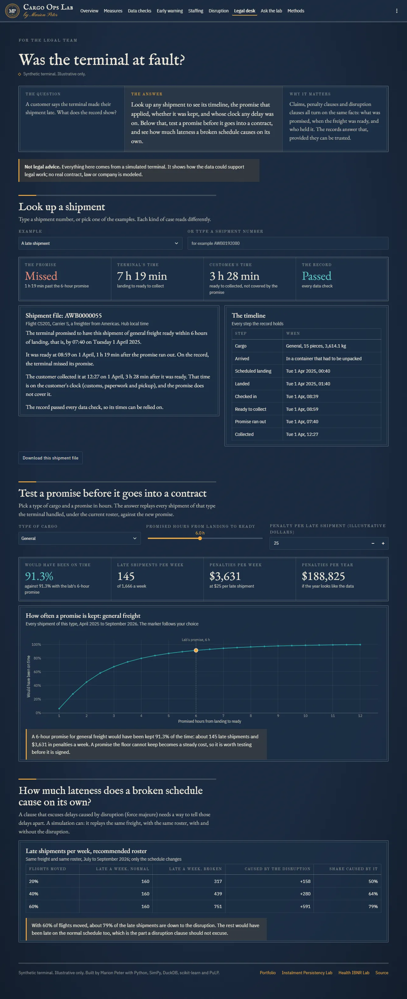 **Legal desk**: a plain shipment file to download, a contract promise tester, lateness caused by the disruption alone | 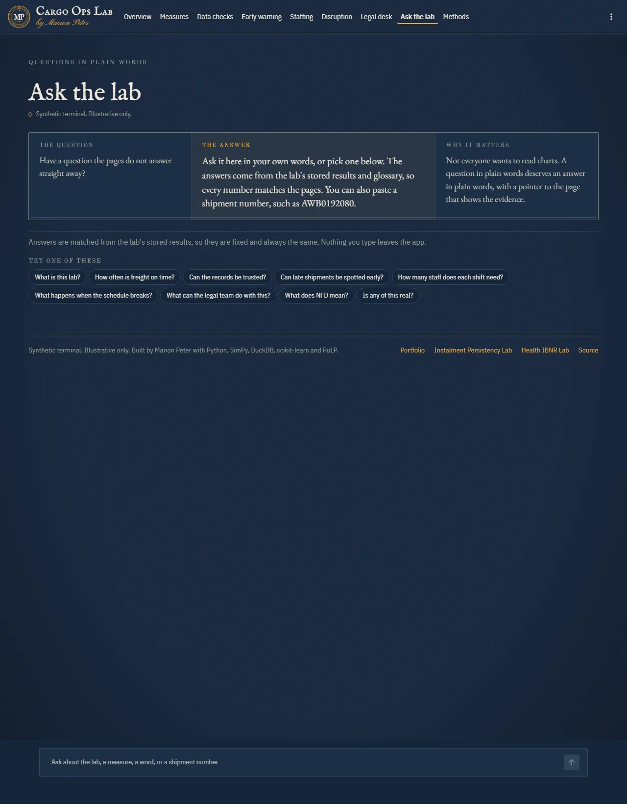 **Ask the lab**: questions in plain words, answered from the stored results |
| 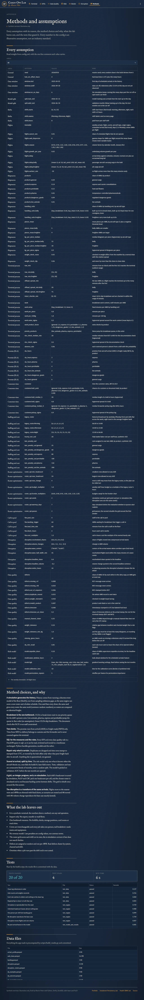 **Methods**: the glossary, every assumption with its reason, method choices, limits and tests | 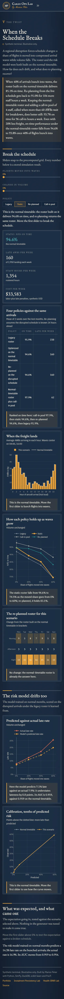 **On a phone** |

A 60 to 90 second walk-through (the story on the Overview, then Disruption: moving 40% of flights into rush hours and
switching from the recommended to the re-planned roster) goes here: `assets/screenshots/walkthrough.gif`.

## Context

- **Milestones.** The lab uses the import half of the Cargo iQ route map: arrival (ARR), received from flight at
  breakdown (RCF), customer notified that freight is ready (NFD) and delivery (DLV). The handler's segment runs from
  ARR to NFD. Source: IATA Cargo Webinars, Cargo iQ, 12 October 2020, slide 27, "Basic Cargo iQ Route Map"
  ([PDF](https://www.iata.org/contentassets/23608a1cdaa543ef877cc617ce99d21e/cargo-iq-master-slides.pdf)).
- **Scale of a Gulf hub.** Dubai International handled 2.15 million metric tonnes of cargo in 2025, eleventh in the
  world and down 1.4% on the year before, according to the Airports Council International traffic dataset as reported
  by Khaleej Times on 15 July 2026
  ([article](https://www.khaleejtimes.com/business/aviation/dubai-airport-ranked-second-busiest-as-global-passenger-traffic-reaches-10-billion-in-2025)).
- **A broken schedule is not hypothetical.** Reporting the airport operator's first-quarter 2026 traffic, Gulf News
  gave cargo volumes of 399,600 tonnes, down 22.7%, under regional airspace disruption (last updated 4 May 2026,
  [article](https://gulfnews.com/business/aviation/dubai-airport-powers-through-war-disruption-with-6-million-passengers-1.500527813)).
  The original operator release is not linked from the article.
- **Synthetic data.** Everything in the app comes from a seeded simulation. No terminal, airline, airport or system
  vendor is named, carriers are "Carrier A" to "Carrier T", and origins are regions. Promises, work rates, costs and
  penalties are illustrative assumptions in `config.yml`, not industry standards.

## Method

1. **Simulation.** A weekly timetable of belly and freighter flights becomes 18 months of arrivals with delays,
   cancellations and seasonal volume. A SimPy model runs the floor: ULDs are towed in, intact ULDs are checked in,
   everything else waits in one priority queue for the breakdown crew on shift (rostered headcount less random
   absences), and NFD follows a document check. Customer time adds customs holds and forwarder pickup. One seed
   fixes every draw.
2. **KPI dictionary.** Eight measures on the milestones, each with a definition, formula, owner, the decision it
   informs and the DuckDB SQL that computes it (`sql/kpis.sql`, `data/kpi_dictionary.csv`). Handler time and customer
   time are kept apart.
3. **Data quality.** A copy of the feed gets seven defects at known rates (missing RCF, missing NFD, NFD before RCF,
   duplicate resends, weight keyed wrong, invalid product codes, UTC stamps labeled as local time). One SQL rule per
   defect (`sql/dq_rules.sql`) is scored for precision and recall against the injected truth, and must flag nothing on
   the clean log. Safe repairs (deduplicate, re-stamp from UTC) are made; everything else is quarantined.
4. **Risk model.** Each AWB is scored at aircraft arrival with only what is known then (product, handling unit, size,
   carrier, region, arrival hour and delay, rostered crew, backlog at arrival, AWBs due in the next two hours). Logistic
   regression and gradient boosting, trained on April 2025 to March 2026, picked on April to June 2026 and tested on
   July to September 2026. A test fails the build if a post-arrival field becomes a feature.
5. **Roster.** For each weekday and shift, the headcount moves through its allowed range in simulation while the rest
   of the roster stays put; a choose-one-per-shift integer program (PuLP with CBC) trades labor cost against late
   penalties within the staff-hour budget and a limit on change from the legacy roster. Every roster is re-simulated
   end to end before it is reported, because backlog carries from one shift to the next.
6. **Disruption.** A share of flights is moved into arrival waves and volume is thinned, on the test months. Four
   policies meet the same arrivals: legacy, the roster optimized on the normal timetable, a roster re-optimized on the
   disrupted schedule, and the normal-timetable roster plus a call-in pool triggered by backlog. The risk model trained
   on normal months is scored on the disrupted arrivals.

## What I would do with real data

- Map the lab's milestones to the handler's actual milestone feed and its message types, and agree each KPI's
  definition and owner with operations before reporting it.
- Validate the promise by product with the commercial team; the lab's live animals result shows a promise can be
  tighter than the physical process allows.
- Add the constraints the lab leaves out: breakdown teams and equipment, docks, storage, cool rooms and truck slots.
- Measure the cost of a late shipment from contracts and claims rather than a config penalty, and add revenue.
- Re-calibrate the risk model on a schedule, monitor its calibration by week, and retrain when the arrival pattern
  changes.
- Put the SQL rules and KPI definitions under version control with sign-off, and publish a data quality scorecard with
  each monthly report.

## Run it locally

```bash
python -m venv .venv
.venv\Scripts\activate             # Windows; on macOS or Linux: source .venv/bin/activate
pip install -r requirements-build.txt
python scripts/build_results.py    # simulation, data quality, KPIs, model, roster, disruption, tests (about 20 minutes)
streamlit run app.py
```

`requirements.txt` is what the deployed app needs: it only reads the precomputed results in `data/`. The build adds
SimPy, scikit-learn, PuLP with the CBC solver, pytest and Playwright (`requirements-build.txt`). The raw event logs
(about 50 MB) are not committed; the build regenerates them exactly from the seed.
`python scripts/capture.py` takes the screenshots once the app is running.

Deployed on Streamlit Community Cloud with Python 3.12. Community Cloud's documented limits (as of February 2024, and
subject to change) are about 2 CPU cores and 2.7 GB of memory at most; apps without traffic for 12 hours go to sleep
and wake on the next visit.

Ask the lab works without any key: it matches questions to answers written from the stored results. To have Claude
answer instead, held to the same facts, add `ANTHROPIC_API_KEY = "..."` to the app's secrets (Community Cloud: the
app's Settings, then Secrets; locally: `.streamlit/secrets.toml`, which is never committed). It uses Claude Opus 5.5
at low effort, caps each visit at 20 questions, and `CHAT_MODEL = "..."` in the secrets picks another model. Every
question then goes to the Anthropic API and is billed to that key.

## Repository

```
app.py                  entry point and navigation
pages/                  one file per page, nine in all
lab/                    config, schedule, SimPy terminal, defects, KPIs, model, roster, disruption, UI,
                        shipments (the record lookup), ask (the chat)
sql/                    kpis.sql, dq_rules.sql, features.sql
scripts/                build_results.py, capture.py
config.yml              every assumption, one comment each
data/                   results the app reads, headline.json, kpi_dictionary.csv, test_results.csv
tests/                  engine bounds, reconciliation, data quality recall, leakage, splits, headline
docs/                   the README template (numbers are filled from data/headline.json)
```

## Why I built this

CargoShield, my other aviation project, looks at a cargo airline from the booking desk: is this shipment what it says
it is, and what should cover for it cost? I wanted to see the other end, after the aircraft lands, when the same
freight sits on a terminal floor and the promise to the customer starts to run out.

The questions were familiar. Reserving taught me that a figure is only as good as the definitions and the data under
it. A terminal's on-time rate has the same weak points: whose clock the waiting time is on, which milestones never
arrived, which time stamps are in the wrong time zone. So the lab defines each measure first, breaks a copy of the
feed on purpose and measures what each break does to the answer, and only then builds a model or a roster on it.

The broken schedule is the question I most wanted answered. A roster that works on the normal timetable can fail
quietly when flights bunch together, and this year's airspace disruption, which cut a major Gulf hub's first-quarter
cargo by more than a fifth, made that less hypothetical. A simulation is the cheapest place to find out how far
service falls, and what re-planning or a small call-in pool buys back.

I had no terminal's data, so everything here comes from one seeded simulation and says so on every page. The method
is what I would bring to real data, and the section above lists what I would change once I had it.

---

Part of a portfolio at [maidenpeter.github.io](https://maidenpeter.github.io/), alongside the
[Instalment Persistency Lab](https://instalment-persistency-lab.streamlit.app/) and the
[Health IBNR Lab](https://maidenpeter.shinyapps.io/health-ibnr-lab/).
