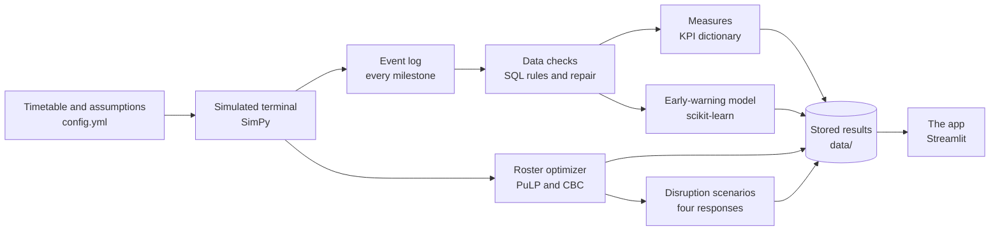

<p align="center">
  
</p>

<h1 align="center">Cargo Ops Lab</h1>

<p align="center">
  <b>When a plane lands with cargo, how often is the freight ready on time,<br>
  and how many people does each shift need to make sure it is?</b>
</p>

<p align="center">
  <a href="https://cargo-ops-lab.streamlit.app/"><b>Open the live app</b></a>
  &nbsp;&middot;&nbsp; <a href="#the-story">The story</a>
  &nbsp;&middot;&nbsp; <a href="#five-questions-five-answers">Five answers</a>
  &nbsp;&middot;&nbsp; <a href="#try-it">Try it</a>
  &nbsp;&middot;&nbsp; <a href="#how-it-works">How it works</a>
  &nbsp;&middot;&nbsp; <a href="#why-i-built-this">Why I built this</a>
</p>

<p align="center"><sub>A portfolio project by Marion Peter. Synthetic terminal. Illustrative only.</sub></p>

<p align="center">
  
</p>

## In one minute

Picture an airport cargo terminal at a busy Gulf hub. Planes land with freight on board. A crew tows the containers
in, unpacks them, checks the paperwork and tells each customer that the goods are ready to collect. Every type of
cargo carries a promise of how fast that happens, and a shipment that misses it is late.

This lab builds such a terminal on a computer and plays out 18 months of freight: {{awbs_total|num}} shipments
weighing {{tonnes_total|num}} tonnes, landed between April 2025 and September 2026. Then it answers the questions a
terminal's analyst would be asked, in words anyone can follow, with the analyst's working one click further down.

> [!NOTE]
> Everything here comes from one seeded simulation. No real terminal, airline, airport or system vendor is named:
> airlines are Carrier A to Carrier T and origins are regions. Promises, work rates, costs and penalties are
> illustrative settings in `config.yml`, each with its reason.

## The story

{{sentences.story|raw}}

The app's overview tells it in six chapters, filling in the shipment's own timeline as you go, and ends on the
question it raises: would fast-tracking it have saved those minutes? The Legal desk opens the same shipment's file.

## Five questions, five answers

| | The question | The answer |
|:-:|---|---|
| **I** | How often is the freight ready on time? | **{{nfd_on_time|pct}}** of shipments are ready to collect within the promise. The slowest tenth take more than {{handler_p90_h|hrs}} from landing. After that, the waiting belongs to customs and the customer: the terminal holds only {{handler_share_of_dwell|pct}} of the time freight spends at the airport. |
| **II** | Can the records be trusted as they arrive? | Taken at face value they say **{{dq_raw|pct}}** on time; the truth is {{dq_truth|pct}}. Automatic checks fix what is safe and set the rest aside, which brings it to {{dq_repaired|pct}}. {{sentences.timezone|raw}} |
| **III** | Can late shipments be spotted when the plane lands? | **{{model_catch|pct0}}** of the shipments that end up late are among the riskiest {{expedite_share|pct0}} an early-warning model flags at landing. A random pick of the same size would catch {{expedite_share|pct0}}. |
| **IV** | How many people should work each shift? | {{sentences.roster|raw}} |
| **V** | What happens when the flight schedule breaks? | {{sentences.headline|raw}} {{sentences.flex|raw}} |

## Try it

The [live app](https://cargo-ops-lab.streamlit.app/) has nine pages. Each opens with the short version (the question,
the answer and why it matters) and keeps the SQL, the scores and the math under the hood, further down.

- **Follow one shipment.** Step through the story on the overview with Back and Next.
- **Filter the measures.** Pick types of cargo, airlines or shifts, and every measure recalculates.
- **Fast-track the riskiest.** Slide the share of shipments flagged at landing and see how many late ones it catches.
- **Break the schedule.** Squeeze flights into rush hours, take freight away, and switch between four staffing responses.
- **Look up a shipment.** On the Legal desk, any shipment number returns a plain file: what was promised, whether it
  was kept, and whose clock any delay was on. It downloads as a text file.
- **Test a contract promise.** Pick a type of cargo and a promise in hours, and see how often it would have been kept
  and what the penalties would cost a week and a year.
- **Ask the lab.** Ask a question in your own words, or paste a shipment number.

<p align="center">
  
  <br><sub>When the Schedule Breaks: {{dis_share|pct0}} of flights moved into rush hours, four staffing responses to the same freight.</sub>
</p>

<p align="center">
  
  <br><sub>The Legal desk: the story's shipment, {{story.id|raw}}, as a plain shipment file. Not legal advice.</sub>
</p>

### Every page

<table>
  <tr>
    <td width="33%" valign="top"><a href="assets/screenshots/terminal_1280.webp"></a><br><b>Overview</b><br><sub>The terminal in one minute, the story, five answers, a glossary</sub></td>
    <td width="33%" valign="top"><a href="assets/screenshots/kpis_1280.webp"></a><br><b>I. Measures</b><br><sub>What counts as on time: the KPI dictionary in plain words, live filters</sub></td>
    <td width="33%" valign="top"><a href="assets/screenshots/dq_1280.webp"></a><br><b>II. Data checks</b><br><sub>Seven planted errors, a check for each, and what bad data does to the headline</sub></td>
  </tr>
  <tr>
    <td width="33%" valign="top"><a href="assets/screenshots/risk_1280.webp"></a><br><b>III. Early warning</b><br><sub>Which shipments will be late: the fast-track slider and what makes a shipment risky</sub></td>
    <td width="33%" valign="top"><a href="assets/screenshots/roster_1280.webp"></a><br><b>IV. Staffing</b><br><sub>How many people each shift needs: current against recommended, service and cost</sub></td>
    <td width="33%" valign="top"><a href="assets/screenshots/disruption_1280.webp"></a><br><b>V. Disruption</b><br><sub>When the Schedule Breaks: four staffing responses, and the model's drift</sub></td>
  </tr>
  <tr>
    <td width="33%" valign="top"><a href="assets/screenshots/legal_1280.webp"></a><br><b>Legal desk</b><br><sub>Was the terminal at fault? A shipment file, a promise tester, lateness caused by disruption alone</sub></td>
    <td width="33%" valign="top"><a href="assets/screenshots/ask_1280.webp"></a><br><b>Ask the lab</b><br><sub>Questions in plain words, answered from the stored results</sub></td>
    <td width="33%" valign="top"><a href="assets/screenshots/methods_1280.webp"></a><br><b>Methods</b><br><sub>The glossary, every assumption with its reason, the limits and the tests</sub></td>
  </tr>
</table>

<sub>Click a card for the full page. Every page also works on a phone, for example
[the disruption page at 390 pixels](assets/screenshots/disruption_390.webp).</sub>

## How it works



A build script runs everything once and stores the results; the app only reads them, so every number on screen and
in this README comes from those files.

1. **Simulation.** A weekly timetable of belly and freighter flights becomes 18 months of arrivals with delays,
   cancellations and seasonal volume. A SimPy model runs the floor: ULDs are towed in, intact ULDs are checked in,
   everything else waits in one priority queue for the breakdown crew on shift (rostered headcount less random
   absences), and NFD follows a document check. Customer time adds customs holds and forwarder pickup. One seed
   fixes every draw.
2. **KPI dictionary.** Eight measures on the milestones, each with a definition, formula, owner, the decision it
   informs and the DuckDB SQL that computes it (`sql/kpis.sql`, `data/kpi_dictionary.csv`). Handler time and customer
   time are kept apart.
3. **Data quality.** A copy of the feed gets seven defects at known rates (missing RCF, missing NFD, NFD before RCF,
   duplicate resends, weight keyed wrong, invalid product codes, UTC stamps labeled as local time). One SQL rule per
   defect (`sql/dq_rules.sql`) is scored for precision and recall against the injected truth, and must flag nothing on
   the clean log. Safe repairs (deduplicate, re-stamp from UTC) are made; everything else is quarantined.
4. **Risk model.** Each AWB is scored at aircraft arrival with only what is known then (product, handling unit, size,
   carrier, region, arrival hour and delay, rostered crew, backlog at arrival, AWBs due in the next two hours). Logistic
   regression and gradient boosting, trained on April 2025 to March 2026, picked on April to June 2026 and tested on
   July to September 2026. A test fails the build if a post-arrival field becomes a feature.
5. **Roster.** For each weekday and shift, the headcount moves through its allowed range in simulation while the rest
   of the roster stays put; a choose-one-per-shift integer program (PuLP with CBC) trades labor cost against late
   penalties within the staff-hour budget and a limit on change from the legacy roster. Every roster is re-simulated
   end to end before it is reported, because backlog carries from one shift to the next.
6. **Disruption.** A share of flights is moved into arrival waves and volume is thinned, on the test months. Four
   policies meet the same arrivals: legacy, the roster optimized on the normal timetable, a roster re-optimized on the
   disrupted schedule, and the normal-timetable roster plus a call-in pool triggered by backlog. The risk model trained
   on normal months is scored on the disrupted arrivals.
7. **Plain-language layer.** A story picked by a fixed rule (the first late shipment in the test months that the model
   flagged), a short version on every page, a glossary, a shipment lookup and a chat, all reading the same stored
   results. Tests check that the story follows its rule and that the lookup and the chat quote the stored numbers.

### The numbers, for analysts

Every figure below is read from `data/headline.json`, which the build writes from the stored results.

| Question | Answer |
|---|---|
| NFD on time | {{nfd_on_time|pct}} of AWBs, cleaned data, legacy roster |
| Handler time, arrival to NFD | Median {{handler_p50_h|hrs}}; the slowest tenth over {{handler_p90_h|hrs}} |
| Handler share of dwell | {{handler_share_of_dwell|pct}} of the time between arrival and delivery; the customer holds the rest |
| Dirty data | The raw feed reads {{dq_raw|pct}} against a true {{dq_truth|pct}}; after repair and quarantine, {{dq_repaired|pct}} |
| Risk model at arrival | {{model|raw}}: AUC {{model_auc|f3}} on the test months; the riskiest {{expedite_share|pct0}} hold {{model_catch|pct0}} of late AWBs |
| Roster | Optimized: {{opt_on_time|pct}} on {{opt_hours_week|num}} staff hours a week; legacy: {{legacy_on_time|pct}} on {{legacy_hours_week|num}} |
| Disruption, {{dis_share|pct0}} of flights in waves | Static {{dis_static|pct}}, re-planned {{dis_replanned|pct}}, static plus call-in pool {{dis_flex|pct}}, legacy {{dis_legacy|pct}} |
| Model drift | {{sentences.drift|raw}} |

## Context

- **Milestones.** The lab uses the import half of the Cargo iQ route map: arrival (ARR), received from flight at
  breakdown (RCF), customer notified that freight is ready (NFD) and delivery (DLV). The handler's segment runs from
  ARR to NFD. Source: IATA Cargo Webinars, Cargo iQ, 12 October 2020, slide 27, "Basic Cargo iQ Route Map"
  ([PDF](https://www.iata.org/contentassets/23608a1cdaa543ef877cc617ce99d21e/cargo-iq-master-slides.pdf)).
- **Scale of a Gulf hub.** Dubai International handled 2.15 million metric tonnes of cargo in 2025, eleventh in the
  world and down 1.4% on the year before, according to the Airports Council International traffic dataset as reported
  by Khaleej Times on 15 July 2026
  ([article](https://www.khaleejtimes.com/business/aviation/dubai-airport-ranked-second-busiest-as-global-passenger-traffic-reaches-10-billion-in-2025)).
- **A broken schedule is not hypothetical.** Reporting the airport operator's first-quarter 2026 traffic, Gulf News
  gave cargo volumes of 399,600 tonnes, down 22.7%, under regional airspace disruption (last updated 4 May 2026,
  [article](https://gulfnews.com/business/aviation/dubai-airport-powers-through-war-disruption-with-6-million-passengers-1.500527813)).
  The original operator release is not linked from the article.
- **Synthetic data.** Everything in the app comes from a seeded simulation. No terminal, airline, airport or system
  vendor is named, carriers are "Carrier A" to "Carrier T", and origins are regions. Promises, work rates, costs and
  penalties are illustrative assumptions in `config.yml`, not industry standards.

## What I would do with real data

- Map the lab's milestones to the handler's actual milestone feed and its message types, and agree each KPI's
  definition and owner with operations before reporting it.
- Validate the promise by product with the commercial team; the lab's live animals result shows a promise can be
  tighter than the physical process allows.
- Add the constraints the lab leaves out: breakdown teams and equipment, docks, storage, cool rooms and truck slots.
- Measure the cost of a late shipment from contracts and claims rather than a config penalty, and add revenue.
- Re-calibrate the risk model on a schedule, monitor its calibration by week, and retrain when the arrival pattern
  changes.
- Put the SQL rules and KPI definitions under version control with sign-off, and publish a data quality scorecard with
  each monthly report.

## Run it locally

```bash
python -m venv .venv
.venv\Scripts\activate             # Windows; on macOS or Linux: source .venv/bin/activate
pip install -r requirements-build.txt
python scripts/build_results.py    # simulation, data quality, KPIs, model, roster, disruption, tests (about 40 minutes)
streamlit run app.py
```

`requirements.txt` is what the deployed app needs: it only reads the precomputed results in `data/`. The build adds
SimPy, scikit-learn, PuLP with the CBC solver, pytest and Playwright (`requirements-build.txt`). The raw event logs
(about 50 MB) are not committed; the build regenerates them exactly from the seed. With the app running,
`python scripts/capture.py` takes the page screenshots and `python scripts/capture_hero.py` the images in this README.

Deployed on Streamlit Community Cloud with Python 3.12. Community Cloud's documented limits (as of February 2024, and
subject to change) are about 2 CPU cores and 2.7 GB of memory at most; apps without traffic for 12 hours go to sleep
and wake on the next visit.

<details>
<summary><b>Ask the lab with Claude (optional)</b></summary>
<br>

Ask the lab works without any key: it matches questions to answers written from the stored results. To have Claude
answer instead, held to the same facts, add `ANTHROPIC_API_KEY = "..."` to the app's secrets (Community Cloud: the
app's Settings, then Secrets; locally: `.streamlit/secrets.toml`, which is never committed). It uses Claude Opus 5.5
at low effort, caps each visit at 20 questions, and `CHAT_MODEL = "..."` in the secrets picks another model. Every
question then goes to the Anthropic API and is billed to that key.

</details>

## Repository

```
app.py                  entry point and navigation
pages/                  one file per page, nine in all
lab/                    config, schedule, SimPy terminal, defects, KPIs, model, roster, disruption, UI,
                        shipments (the record lookup), ask (the chat)
sql/                    kpis.sql, dq_rules.sql, features.sql
scripts/                build_results.py, capture.py, capture_hero.py
config.yml              every assumption, one comment each
data/                   results the app reads, headline.json, kpi_dictionary.csv, test_results.csv
tests/                  engine bounds, reconciliation, data quality recall, leakage, splits, headline, plain layer
docs/                   the README template (numbers are filled from data/headline.json)
assets/                 the seal, page screenshots, README images
```

## Why I built this

CargoShield, my other aviation project, looks at a cargo airline from the booking desk: is this shipment what it says
it is, and what should cover for it cost? I wanted to see the other end, after the aircraft lands, when the same
freight sits on a terminal floor and the promise to the customer starts to run out.

The questions were familiar. Reserving taught me that a figure is only as good as the definitions and the data under
it. A terminal's on-time rate has the same weak points: whose clock the waiting time is on, which milestones never
arrived, which time stamps are in the wrong time zone. So the lab defines each measure first, breaks a copy of the
feed on purpose and measures what each break does to the answer, and only then builds a model or a roster on it.

The broken schedule is the question I most wanted answered. A roster that works on the normal timetable can fail
quietly when flights bunch together, and this year's airspace disruption, which cut a major Gulf hub's first-quarter
cargo by more than a fifth, made that less hypothetical. A simulation is the cheapest place to find out how far
service falls, and what re-planning or a small call-in pool buys back.

I had no terminal's data, so everything here comes from one seeded simulation and says so on every page. The method
is what I would bring to real data, and the section above lists what I would change once I had it.

---

<p align="center">
  <sub>Part of a portfolio at <a href="https://maidenpeter.github.io/">maidenpeter.github.io</a>, alongside the
  <a href="https://instalment-persistency-lab.streamlit.app/">Instalment Persistency Lab</a> and the
  <a href="https://maidenpeter.shinyapps.io/health-ibnr-lab/">Health IBNR Lab</a>.</sub>
</p>
